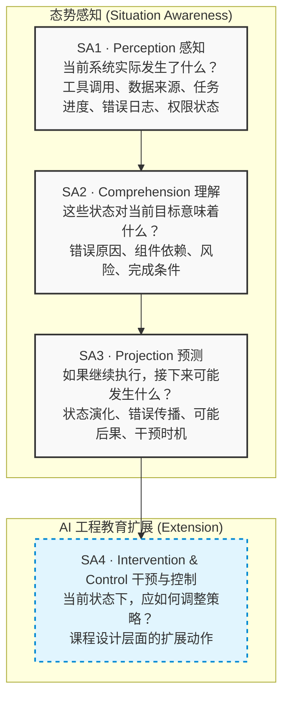
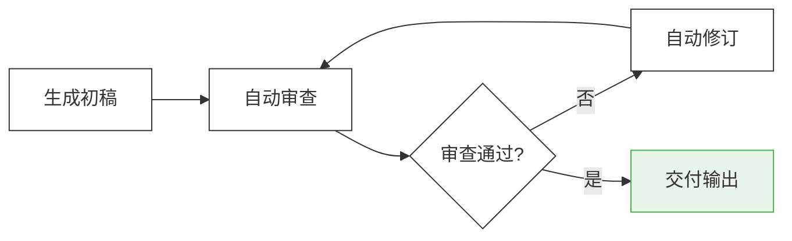
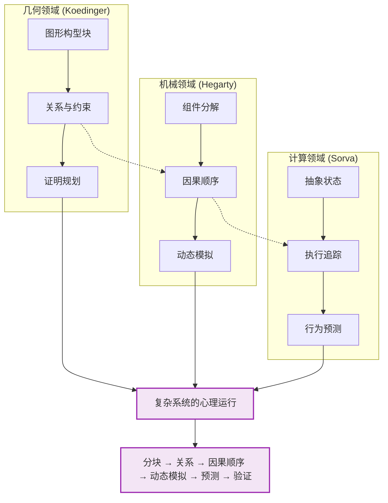
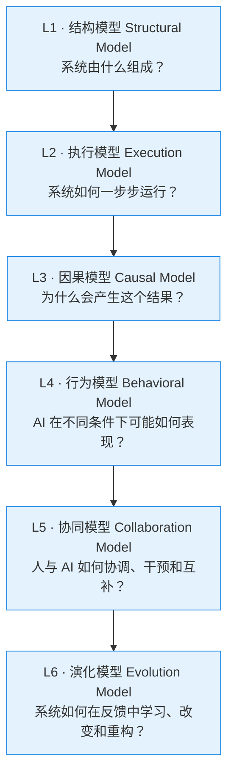
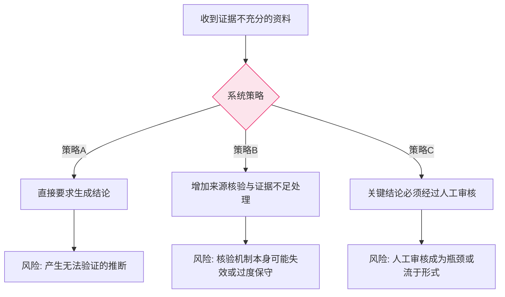
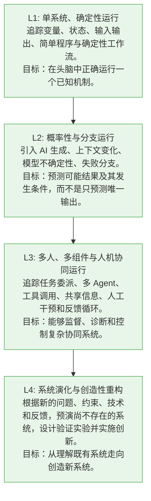
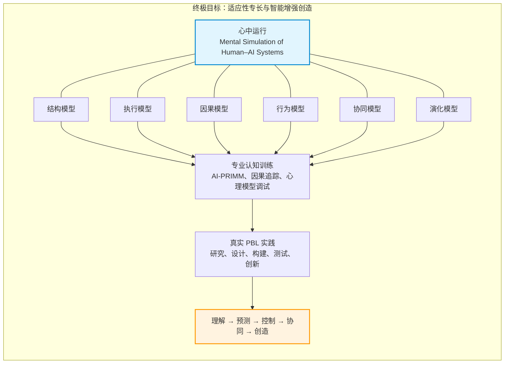

# 从“心中成图”到“心中运行”：AI 工程认知的理论体系与训练方法

我认为，“心中运行”值得在 `ai-practice` 学科包中发展为一个独立的核心训练领域，而不是仅仅作为系统思维的一项子技能。

几何心理动画的本质，是人在没有实际操作图形的情况下，在头脑中模拟图形的生成、变换、约束与关系变化。

AI 工程中的“心中运行”则更进一步：

> 人在没有实际执行智能系统之前，能够在头脑中构建系统的因果模型，模拟信息流、控制流、状态变化、AI 的可能行为以及人机交互的后果，并据此规划、预测、诊断和重构系统。

这里的“模拟”并不是要求人能够预测大语言模型的每一个输出 token，而是要求人能够理解系统的运行机制、可能的行为范围、不确定性、失败条件与控制边界。

两者的认知结构有很强的对应关系。

| 几何心理动画 | AI 系统心理运行 |
| :--- | :--- |
| 图形构型块 | 系统功能组件 |
| 图形生成顺序 | 系统构建与执行顺序 |
| 点、线、角的关系 | 数据、接口、状态与依赖关系 |
| 动点轨迹 | 信息流与状态迁移 |
| 运动约束与不变量 | 系统约束、接口契约与不变量 |
| 特殊位置与退化 | 边界条件与故障状态 |
| 辅助线构造 | 新组件、校验机制与反馈回路 |
| 证明规划 | 工程规划与验证路径 |
| 几何直觉的形式化验证 | 系统直觉的实验与评测验证 |

不过，AI 系统与几何图形存在一个关键差异：几何关系通常是确定性的，智能系统的行为则具有概率性、环境依赖性和一定程度的不可预测性。

所以，“心中运行”必须同时包含确定性机制推演、概率性行为预测和不确定性管理。

## 一、最值得借鉴的八条理论研究路线

我查阅了计算机教育、认知科学、认知工程、人因工程和 Human–AI Interaction 的相关研究。其中，Sorva 的概念执行机器、Endsley 的态势感知、Johnson-Laird 的心理模型和人机共享心理模型研究，尤其值得像几何课研究 Koedinger 一样深入开采。

### 1. Johnson-Laird：心理模型理论（Mental Model Theory）

心理模型理论的核心观点是，人并非只能通过抽象符号规则进行推理，还可以在头脑中建立代表现实或可能情境的内部模型，并通过操作这些模型得出结论。

对于 AI 工程教育，关键在于区分三种理解：

| 理解层次 | 学生的表现 |
| :--- | :--- |
| 陈述性知识 | 知道什么是 RAG、Agent、上下文窗口 |
| 结构性理解 | 知道这些组件之间怎样连接 |
| 可运行的心理模型 | 能根据具体输入预测系统行为，解释异常，并设计改进 |

只有第三层真正接近我们所说的“心中运行”。

例如，学生知道 Agent 可以调用工具，并不意味着他理解：

> 如果工具返回错误信息、调用失败或者返回值不完整，后续 Agent 会怎样行动？系统能否识别失败？是否会继续执行？人在哪里介入？

这些问题要求学生在脑海中构建一个可以运行、可以改变条件、可以产生不同后果的内部系统模型。

2026 年发表的人机交互心理模型系统性范围综述，也将用户对 AI 的内部表征作为理解人机交互行为的重要研究对象，并区分心理模型、信任和对 AI 意图的归因。

> **课程转化**：建立心理模型、运行模型、比较预测与实际结果、修正心理模型。

### 2. Sorva：概念执行机器（Notional Machine）

计算机科学教育 · 2013

这是与几何心理动画最直接对应的成熟研究方向。

Sorva 将 Notional Machine 描述为一台用于理解某类程序如何执行的抽象计算机。他的综述指出，建立正确的概念执行机器是初学者学习编程面临的重要挑战。

学习编程的学生不能只理解代码语法，还需要在头脑中模拟：

- 当前变量和状态是什么；
- 下一步执行什么指令；
- 条件判断会进入哪个分支；
- 数据如何变化；
- 哪些信息会被保留。

这正是计算机领域的“心理动画”。

我建议将这一理论扩展到 AI 工程课程，建立一个 AI Notional Machine（AI 概念执行机器）。
![[Pasted image 20261126162040.png]]


学生需要能够在没有实际调用 AI 之前，沿着这个模型预测系统可能发生什么。

尤其重要的是区分：

> 模型生成了一条工具调用请求，不等于工具已经执行；工具返回成功，不等于业务目标已经实现；AI 声称记住了某件事，不等于信息已经持久化。

这种概念执行机器可以成为 AI 学科包的基础认知模型。

### 3. Endsley：态势感知理论（Situation Awareness）

认知工程与人因工程 · 1995

如果说 Notional Machine 解决的是“系统如何运行”，那么 Endsley 解决的是“人如何在动态系统中保持理解和控制”。

态势感知理论源于航空、复杂设备操作等动态决策环境，经典框架包含三个层级：感知环境中的要素、理解当前情境、预测未来状态。



这套理论特别适用于 Agent、人机协同和自动化工作流课程。

例如：

> AI 告诉学生“任务已经完成”。
> - SA1：实际有哪些文件、测试结果、执行日志？
> - SA2：这些证据是否满足任务要求？
> - SA3：如果立即部署，可能发生什么问题？

掌握态势感知的学生不会被 AI 的语言表现牵着走，而是能够根据真实状态作出判断。

我建议将三个层级直接转化成训练范式和诊断标准，并进一步增加一个课程设计层面的动作：干预与控制。

> **注意**：这个第四动作是我们为了 AI 工程教育提出的扩展，不是 Endsley 原有的第四级态势感知。

### 4. Sarter & Woods：模式感知与自动化意外（Mode Awareness）

认知系统工程 · 1995

这是一个容易被 AI 教育忽略、但极具现实价值的研究方向。

Sarter 和 Woods 在航空自动化研究中发现，当操作者无法准确理解自动化系统当前处于什么模式、为什么进入该模式、下一步会做什么时，就容易发生所谓的 Automation Surprise（自动化意外）。

在 AI 系统中，同样存在类似问题。

| 用户的心理预期 | 系统实际可能发生的情况 |
| :--- | :--- |
| AI 正在研究问题 | AI 正在依据已有知识生成文本 |
| AI 已经调用工具 | AI 只是提出了工具调用请求 |
| AI 已经保存信息 | 信息可能仅存在于当前上下文 |
| AI 已经完成任务 | 只生成了方案，并未执行 |
| AI 正在自主检查结果 | 系统可能没有任何独立验证环节 |
| AI 理解我的全部意图 | 当前上下文可能缺少关键约束 |

这种差异可以称为心理模型与真实系统状态之间的失配。

建议开发独立的“模式辨别训练”，让学生面对不同 AI 工作状态，判断系统目前实际具备什么信息、能力和权限。

特别是学习 Agent 时，要训练学生区分：

- 规划态与执行态；
- 生成态与检索态；
- 建议态与决策态；
- 临时上下文与持久化状态；
- 自动执行与等待人工确认。

这些训练不能仅考察术语，而要让学生根据实际记录判断当前系统状态。

### 5. Gary Klein：专家决策与心理预演

Naturalistic Decision Making · 自然情境决策

Klein 的 Recognition-Primed Decision Model（识别启动决策模型）研究了专家如何在复杂现实环境中迅速作出决策。

其中的重要机制是：专家识别熟悉的情境结构，形成一个可行行动方案，再通过心理模拟判断该方案可能产生什么后果。

这与 Koedinger 的几何构型识别存在很有启发性的相似性。

| 几何专家      | 工程专家            |
| :-------- | :-------------- |
| 识别有意义的构型块 | 识别有意义的系统状态与问题模式 |
| 激活相关定理与方法 | 激活已有案例与工程策略     |
| 预测可能的证明路线 | 预测可能的执行过程       |
| 发现缺失条件    | 发现风险、缺失组件与信息    |
| 调整证明规划    | 修订架构和行动方案       |

相关的 Prospective Hindsight（前瞻性回顾）研究，则通过把未来某一事件假设成已经发生，引导人生成可能的原因解释。

可据此引入一个非常有用的工程最佳实践：Pre-mortem（事前验尸）。

在项目尚未启动时，让学生假设：

> “三天后，这个 AI 研究助手彻底失败了，而且使用者不再信任它。”

学生需要在头脑中逆向模拟导致失败的可能路径，找出最早的关键缺陷，并提出检测与预防方案。

这种训练比单纯问“项目有什么风险”更具体，因为它要求学生把风险组织成一条可以解释的因果链。

### 6. Kulesza 等：解释性调试（Explanatory Debugging）

Interactive Machine Learning · 2013–2015

这是我认为对人理解 AI 并与之持续协同最具直接价值的研究之一。

传统调试主要是：

> 人发现程序错误，然后修改代码。

解释性调试则强调双向过程：

> 智能系统向人提供关于预测的解释，人依据理解向系统反馈必要的修正。

Kulesza 等人在交互式机器学习系统中的实证研究发现，这类机制能够改善用户对系统的理解与纠错效率。

它意味着，人机协同不仅是人不断修改 AI 的输出，更是人不断修正自己对 AI 的理解。

例如：

学生要求 AI 根据资料生成一个研究结论，结果发现其中出现了未经证实的推断。

普通提示词训练可能教学生补一句：

> “不要产生幻觉。”

解释性调试训练则要求进一步追问：

- 系统实际获得了哪些材料？
- 哪一部分输入不足以支持结论？
- 事实与推断之间的边界在哪里？
- 是检索错误、任务约束不足、生成偏差，还是验证流程缺失？
- 怎样修改系统并验证所提出的原因？

这里不仅修复了一个输出，还修复了学生的系统心理模型。

> **注意**：原研究针对的是可解释的交互式机器学习系统，不能直接假定大语言模型能够可靠解释自身内部推断过程。LLM 生成的自我解释也需要通过外部实验、输入输出对照和执行记录校验。

### 7. Sterman：系统动力学与反馈误判

System Dynamics · 1989

“心中运行”不能只模拟线性工作流，还要训练学生理解反馈、延迟、累积与非线性关系。

Sterman 通过动态决策实验研究人们对反馈系统的误判，实验涉及多个参与者、反馈关系、时间延迟和非线性机制。

这一研究对于 Agent 工作流非常有意义。

例如，某个系统设计了自动审查与自动修订：



反馈循环并不天然带来质量提升。它的效果取决于评价信号、修订机制、终止条件及各组件的失败相关性。

学生需要能够预测：

> 增加审查次数是否一定更可靠？多个 Agent 是否会共享相同错误？不断修改是否可能破坏原先正确的内容？系统会不会进入无法终止的循环？

这也是为什么“心中运行”应包含多轮动态演化，而不能只停留在流程图阅读。

### 8. Shared Mental Models：人机共享心理模型

团队认知与人机协作 · 2022–2026

这一研究方向将心理模型从个体扩展到协作团队。

2022 年关于人机团队共享心理模型的理论综述，以及2026年发表的人机团队互补性框架，都将任务理解、能力理解、协作协调、信任校准等视为值得研究的机制。

对 AI 工程教育而言，这意味着学生不仅要理解 AI 怎么运行，还要理解：

> AI 系统获得的任务表征，与人自己头脑中的任务表征是否一致。

例如，人认为任务的第一优先级是科学严谨性，而提供给 AI 的上下文却主要强调语言流畅和输出速度。

此时，问题不是 AI 完全不具备科学研究能力，而是人机之间的目标、约束和评价标准没有得到有效协调。

建议将传统的提示词训练升级为：

| 协同要素 | 学生需要建立的心理模型 |
| :--- | :--- |
| 目标 | AI 获得了怎样的任务目标？ |
| 背景 | AI 实际能够访问哪些信息？ |
| 分工 | AI 应承担什么，人必须承担什么？ |
| 能力 | 当前系统在哪些任务上可靠？ |
| 进度 | 任务现在处于什么状态？ |
| 成功标准 | 什么证据才意味着任务完成？ |

需要强调的是，这里的“共享心理模型”并不意味着 AI 与人具有相同的主观心理体验，而是指人机之间形成足以协调任务的功能性表征、信息与行为预期。

## 二、最重要的新发现：Hegarty 的机械心理动画研究

在进一步检索中，我发现了一条与几何心理动画和 AI 系统心理运行联系尤其紧密的研究路线。

Mary Hegarty 在1992年的论文《Mental Animation: Inferring Motion from Static Displays of Mechanical Systems》中提出，人进行机械心理动画时，会将机械系统分解为对应于各组件的较小单元，再按照系统运行的因果顺序逐步模拟这些组件。

2004年的《Mechanical Reasoning by Mental Simulation》进一步讨论了机械推理中的心理模拟机制。

这可能是连接 Koedinger 几何构型块研究与 AI 工程心智建模的最佳理论桥梁之一。

三者存在一个共同的认知机制：
![[Pasted image 20261126161739.png]]



> 这是跨研究领域的综合模型，不是三位研究者共同提出的现成理论。

尤其值得借鉴的是 Hegarty 在2003年与 Kriz、Cate 关于内部心理动画和外部计算机动画的研究。他们直接比较了静态图、运动预测、计算机动画等教学条件对机械系统心理模型的影响。

这为 AI 工程课程提出了一个非常明确的研究问题：

> 直接观看 Agent 执行过程，和先在头脑中预测 Agent 执行过程、再观看真实执行轨迹，两种学习方式是否会产生不同质量的系统心理模型？

我建议把这个问题作为学科包的重点本地验证假设。

## 三、建立 AI 心理运行的六层模型

综合上述研究，我建议不要只训练一种系统心智模型，而是建立六层相互关联的心理模型。



> 这里的 L1–L6 代表心理模型的六个层面，不是 Growth OS 的能力成熟度等级。正式学科包中可以使用 M1–M6，避免命名冲突。

### M1：结构心理模型——看见系统的骨架
训练组件分解、层次关系、功能职责、接口与边界。

学生看到一个 AI 应用时，不只是看到聊天界面，而能够识别模型、知识库、工具、状态管理、权限控制、评测等实际或候选组件，并通过证据确认它们是否存在。

### M2：执行心理模型——让系统在头脑中运行
训练执行顺序、数据流、控制流、状态迁移、分支与循环。

这是与几何心理动画最直接对应的层面。

### M3：因果心理模型——理解为什么
训练因果传播、依赖关系、反馈、反事实推理、错误定位。

de Kleer 与 Brown 的定性物理研究，以及 Forbus 的 Qualitative Process Theory，都试图根据系统结构和局部机制推导整体行为及因果解释。它们为“不依赖精确数值、先建立定性运行模型”的训练提供了理论参考。

学生可以不懂完整的 Transformer 数学推导，但仍需理解为什么缺失信息、错误检索或不充分的验证会影响系统结果。

### M4：行为心理模型——理解概率性 AI
这一层是区别于传统计算机系统的关键。

学生需要理解：

> 同样的输入未必产生完全相同的输出；模型可能在一种任务中表现很好，在另一种看似相近的任务中失败；语言表达的确定性不等于结论正确；系统行为不能仅由静态架构图完全推出。

因此，要从预测唯一答案，升级到预测可能行为、失败条件和不确定性范围。

### M5：协同心理模型——理解人在系统中的位置
学生不仅预测 AI，还要预测人类判断与 AI 行为之间的相互影响。

例如，AI 提出一个看似合理的方案，人会不会因为 AI 表达自信而放弃自己的判断？AI 不知道学生的真实目的时，学生能否识别目标失配？什么时候应该介入、停止、重新委派？

这涉及共享心理模型、态势感知、自动化偏误和恰当依赖。

### M6：演化心理模型——理解系统如何变化
训练跨轮次、跨任务、跨版本的动态系统思维。

例如，当系统增加长期记忆、引入自动审查、改变模型或部署环境时，系统的行为和风险会发生什么变化？新的反馈机制会改善质量还是放大错误？

这是真正走向复杂 AI 工程设计的高级能力。

## 四、最成熟的教学实践：PRIMM 的 AI 工程扩展

Sentance、Waite 和 Kallia 提出的 PRIMM，是目前非常值得直接借鉴的计算机教育实践。

2019年的研究在13所学校、493名11—14岁学生中进行了评价，年龄范围与你的中学课程设计高度相关。PRIMM 由五个环节组成：Predict、Run、Investigate、Modify、Make。

原有 PRIMM 已具有中学编程教学的研究基础；下面将其扩展到 AI 工程领域，是新的设计候选方案。

### AI-PRIMM：从预测到创造


它与几何心象课程的训练节奏天然呼应：

| 几何心象训练 | AI-PRIMM |
| :--- | :--- |
| 先心中成图 | Predict |
| 观看几何动画 | Run |
| 比较心象与实际图形 | Investigate |
| 改变条件，重新推演 | Modify |
| 创造辅助构型与证明路线 | Make |

区别是 AI-PRIMM 的终点并非仅仅理解系统，而是能够自主改变系统、创造系统。

## 五、八种值得开发成正式任务族的心理运行训练

建议将下列任务族作为 `ai-practice.md` 的重要组成部分。

| 任务族 | 训练操作 | 主要理论来源 |
| :--- | :--- | :--- |
| 系统块快认 | 快速识别功能组件、接口及依赖 | Hegarty、Notional Machine |
| 消失状态重建 | 根据前后状态推断中间执行过程 | 心理动画、状态追踪 |
| 无运行预测 | 在系统执行前预测结果与路径 | PRIMM |
| 因果链追踪 | 解释错误怎样从一个组件传播到另一个 | Qualitative Reasoning |
| 反事实扰动 | 改变一个条件，预测系统新行为 | 心理模拟、系统动力学 |
| 模式意外辨别 | 判断 AI 处于什么执行与权限状态 | Sarter & Woods |
| 心理模型调试 | 由预测失败反推自己理解中的错误 | Explanatory Debugging |
| 人机协同预演 | 预测不同分工、沟通与干预策略的结果 | Shared Mental Models、Endsley |

下面以三个任务为例，说明真正应该训练到什么程度。

### 训练一：Agent 消失状态重建

给出一个系统的初始状态与最终结果，但隐藏其中间执行记录。

> **已知**： 用户要求 AI 查询资料并生成带有来源的报告。
> **结果**： 报告语言流畅，但是其中一个引用不存在。

学生需要提出至少两种可能的执行路径，说明还需要查看哪些证据才能区分它们。

> **关键在于不能把这一题设计成唯一答案题。**

不存在的引用可能来自未检索直接生成、错误资料、检索结果被错误解释等不同机制。优秀学生应当知道，缺乏运行记录时无法唯一定位原因。

评价的是假设生成、因果推理和不确定性管理。

### 训练二：概率分支心理预演

假设一个 AI 工作流收到一份证据不充分的资料。



> 思考：系统没有显式核验环节，哪些输出风险无法由架构约束消除？

> 教学示意模型。实际分支取决于模型、指令、工具实现与人工流程。

这种训练要求学生从线性心理动画升级到分支式心理运行。

在真实 AI 工程中，这是必不可少的。

### 训练三：双重心理模型调试

当 AI 系统输出不符合预期时，学生需要同时检查两个模型：

一个是外部工程系统的实际结构，另一个是自己对系统的理解。

例如：

> 学生预测知识库中增加一条资料后，AI 一定会正确回答相关问题。
> 实验却发现输出没有变化。

学生不能直接让 AI 修改程序，而要依次检查：

| 待检验假设 | 对应证据 |
| :--- | :--- |
| 资料没有成功保存 | 存储状态 |
| 资料保存了，但没有被检索 | 检索记录 |
| 资料检索到了，但未进入模型上下文 | 上下文记录 |
| 资料进入了上下文，但被错误解释 | 输入输出对照 |
| 我的预测本身不成立 | 多组控制变量实验 |

真正的学习发生在学生发现并修正自己心理模型中的错误时，而不只是系统最终恢复运行时。

## 六、AI 心理运行的专业工程最佳实践

除了教育研究，还应引入软件工程、Agent 工程和 SRE 的成熟实践。但应把它们转化为认知训练，而不是照搬企业流程。

| 工程实践 | 转化为学生认知训练 |
| :--- | :--- |
| Dry Run 预演 | 实际执行前手工推演数据和状态 |
| Sequence Diagram 时序图 | 预测组件之间的通信顺序 |
| State Machine 状态机 | 判断当前模式、转换条件和终止状态 |
| Distributed Tracing 分布式追踪 | 根据实际记录重建系统执行过程 |
| Fault Injection 故障注入 | 预测局部故障的传播与恢复 |
| Pre-mortem 事前验尸 | 模拟未来失败并逆向寻找原因 |
| Regression Testing 回归测试 | 预测修改可能破坏哪些原有能力 |
| Observability 可观测性 | 设计足以判断真实系统状态的信息 |
| Human-in-the-loop 人工介入 | 设计人在何处、依据什么作出判断 |
| Architecture Trade-off 架构取舍 | 比较简单流程与复杂 Agent 的成本和收益 |

Anthropic 的《Building Effective Agents》强调区分工作流与自主 Agent，从简单方案起步，依靠全面评测逐步增加复杂度，并提高执行过程的透明性。这些是值得吸收的产业实践，而非针对中学生的教学效果研究。

Google SRE 关于分布式系统监控的实践，则提供了如何通过可观测信号理解真实运行状态的工程范例。

Amershi 等人的18项人机交互设计指南，也非常适合转化为学生的工程设计检查项：明确 AI 能力、支持纠错、允许拒绝、管理能力变化、给予用户适当控制。

这里有一个重要的教育原则：

> 一个无法被有效观察和验证的系统，即使学生画出了漂亮的架构图，也很难证明学生真正理解并控制了它。

所以心理运行训练最终必须连接真实系统的可观测性设计。

## 七、建立心理运行能力的可测标准

参考几何课对心理操作记录的要求，AI 工程课不应只收集最终答案，而应收集学生的预测、解释、判断和模型修订证据。

| 测评维度 | 可观察证据 | 伪掌握表现 |
| :--- | :--- | :--- |
| 结构理解 | 独立重建系统组件与依赖 | 能复述 AI 生成的架构说明 |
| 执行预测 | 给定输入，正确追踪关键状态 | 运行之后才解释结果 |
| 因果推理 | 识别可能原因并设计鉴别实验 | 把最后一个报错当成根因 |
| 不确定性理解 | 区分必然、可能、未知的行为 | 把概率性系统当成确定性程序 |
| 反事实推理 | 改变条件后正确预测后果 | 只能解释原始示范案例 |
| 协同判断 | 根据真实状态决定是否干预 | 一律信任或一律拒绝 AI |
| 心理模型修订 | 明确原预测错误在哪里 | 只修改输出、不修正理解 |
| 系统创造 | 将心理模型用于设计新系统 | 直接让 AI 生成完整方案 |

建议每次关键训练至少形成一份简洁的心理运行记录：

```text
1. 系统表征：我认为系统由哪些组件组成？
2. 初始条件：系统当前有什么信息和状态？
3. 心中运行：接下来可能发生什么？
4. 因果依据：为什么预计会这样？
5. 不确定性：哪些结果目前无法确定？
6. 实际证据：真实运行发生了什么？
7. 模型修订：我原先的理解哪里需要改变？
8. 新的预测：改变条件后，又会发生什么？
```

但与几何包的心理操作记录一样，不应将填写完整记录表变成每一轮的机械要求。复杂任务可以保留完整记录，简单任务只需捕捉关键预测和修订。

## 八、建议形成四级训练进阶

以下为课程设计层面的候选进阶，不等同于 Growth OS 正式的 L1–L4 等级定义。



第四级尤其重要。

几何高手能够在头脑中构造原图不存在的辅助线；优秀的 AI 工程设计者也需要在头脑中构造原系统不存在的新组件、新接口、新反馈机制和新协同方式，并提前判断这些改变可能带来什么。

这就是从心理模拟走向工程创造。

## 九、核心研究文献：建议优先开采顺序

| 优先级 | 文献 | 对学科包的价值 |
| :--- | :--- | :--- |
| P0 | [Hegarty, 1992 — Mental Animation](https://pubmed.ncbi.nlm.nih.gov/1402712/) | 心理动画、组件分解、因果执行 |
| P0 | [Sorva, 2013 — Notional Machines](https://eric.ed.gov/?id=EJ1042409) | 概念执行机器与程序心理模型 |
| P0 | [Sentance et al., 2019 — PRIMM](https://doi.org/10.1080/08993408.2019.1608781) | 中学生系统预测与操作训练 |
| P0 | [Endsley, 1995 — Situation Awareness](https://doi.org/10.1518/001872095779049543) | 动态感知、理解、预测 |
| P0 | [Kulesza et al., 2015 — Explanatory Debugging](https://openaccess.city.ac.uk/id/eprint/13819/) | 系统理解与心理模型修订 |
| P0 | [Shared Mental Models in Human-AI Teams, 2022](https://doi.org/10.1080/1463922X.2022.2061080) | 人机任务协调与共享表征 |
| P1 | [Sarter & Woods, 1995 — Mode Awareness](https://doi.org/10.1518/001872095779049516) | 自动化意外与控制状态理解 |
| P1 | [Hegarty, 2004 — Mechanical Reasoning by Mental Simulation](https://pubmed.ncbi.nlm.nih.gov/15165554/) | 心理模拟机制 |
| P1 | [Forbus, 1984 — Qualitative Process Theory](https://dspace.mit.edu/entities/publication/b0fc8bdb-a8bb-4560-8de5-c1528362df2f) | 定性因果推演 |
| P1 | [Sterman, 1989 — Misperceptions of Feedback](https://www.sciencedirect.com/science/article/pii/0749597889900411) | 反馈回路与动态系统误判 |
| P1 | [Amershi et al., 2019 — Guidelines for Human-AI Interaction](https://doi.org/10.1145/3290605.3300233) | 人机交互工程设计 |
| P1 | [Users’ Mental Models within Human–AI Interaction, 2026](https://doi.org/10.1007/s00146-026-03038-1) | 最新心理模型研究综述 |
| P2 | [Human–AI Teaming Complementarity Framework, 2026](https://academic.oup.com/pnasnexus/article/5/3/pgag030/8490283) | 人机互补、协同与责任 |

> P0–P2 表示建议研发优先级，并不代表证据质量的学术排名。

## 十、对 `ai-practice.md` 的进一步架构修订建议

经过这轮研究，我建议调整上一版学科包方案中“系统心智建模”的地位，将其提升为核心认知主轴。



与几何学科包相比，可以形成一组极有价值的对称关系。

| | 几何刻画思维 | AI 工程思维 |
| :--- | :--- | :--- |
| 核心能力 | 心中成图 | 心中运行 |
| 专家认知内核 | 构型与几何关系 | 系统、因果与行为 |
| 心理操作 | 拆解、运动、变换、重组 | 追踪、分支、模拟、干预 |
| 训练主线 | 心象—图形—证明 | 心智模型—实验—工程 |
| 高阶能力 | 创造辅助构型 | 创造新的系统与协同机制 |
| 验证方式 | 数学证明 | 实验、评测、运行证据 |
| 最终目标 | 几何结构洞察 | 复杂智能系统洞察与驾驭 |

### 研究边界

这里提出的六层心理模型、八种训练范式、AI-PRIMM 和四级训练进阶，均属于综合已有研究后形成的课程研发候选方案，不是已经被统一验证的成熟 AI 教学体系。

尤其需要在真实课程中验证三件事：

- 先心理预演再运行，是否比直接操作 AI 更有利于建立准确的系统心理模型。
- 心理模型训练能否迁移到陌生 AI 工具、Agent 架构和真实工程任务。
- 学生是否能在广泛使用 AI 的同时，持续提升独立理解、协同判断和创造能力。

不应在验证之前将它们整体标记为 `LOCAL_VALIDATED`。


我的核心建议是：在 `ai-practice.md` 中正式设立“系统心理运行与人机协同认知”专节，作为类似于 `geometry-imagery.md` 中五段心象训练的专业认知底座，但不强制采用固定章轮模板。

因为真正驾驭 AI 的人，不能只是知道如何向 AI 提出要求，也不能只是等待 AI 交付结果。

他需要在行动之前预见系统，在行动之中理解系统，在行动之后修正系统，并最终能够在头脑中创造一个尚未存在的系统，再借助 AI 将其转化为现实。