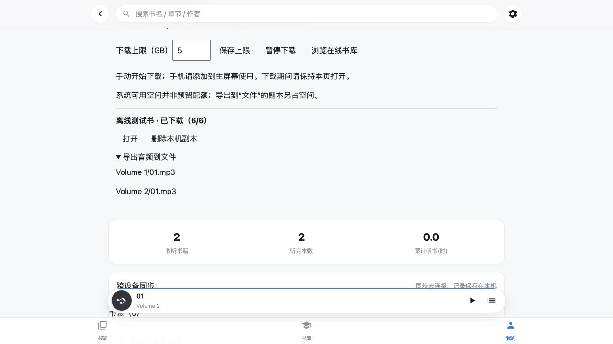

# PWA 手动下载与本机优先播放验收（2026-11-05）

## 功能

- 在书籍页点击“下载整本供离线使用”；下载音频、分卷目录、封面简介、EPUB/PDF/导读，以及书级和卷级 manifest 对应的当前发布版本。跳过历史版本和工作目录。
- “我的”页管理本机下载：默认 5 GB，可修改上限、暂停/续下、查看文件完成数、打开本机书籍、删除本机副本。当前书籍正在使用时拒绝删除。
- 文件成功完整写入并通过声明大小检查后才登记；全套文件完成才标记整书完成。中断后保留完成文件，继续时不重复下载。下载使用前台流式写入；不承诺 iOS 关闭 PWA 后继续下载。
- 本机音频优先，不再请求签名地址；从已下载列表打开后，目录和跟读资料也从本机读取。缺少本机文件时明确提示切回在线书库，不暗中联网播放。
- 独立 CacheStorage 保存下载，按书库根和账号隔离；同账号内外网切换使用同一本机库。Web Locks 可用时防止多窗口并发修改。
- 容量预检、流式计量和 QuotaExceededError 恢复；请求持久存储，不自动删除手动下载。上限约束下载文件，浏览器元数据和外壳额外占空间；不能向系统预留空间。
- Service Worker 为本机音频提供 Range/206/416；带查询版本参数的外壳请求可离线回退。升级外壳缓存 v61 不清除手动下载库。
- 导出提供同源 download 链接；支持文件分享的设备可先“准备分享文件”，再点击“分享 / 存储到文件”。导出副本另占空间，不作为 PWA 内部播放来源。
- PDF.js 沿用现有 3.11.174，改为本地资源并保留许可证；PDF 阅读器和 KaTeX 及 woff2 字体随外壳缓存。

## 测试

- `node --test studio/audiobooks/*.test.mjs tools/readalong/tests/*.mjs`：73 项通过，新增 23 项，未删除既有测试。
- `node --import tsx --test quartz/**/*.test.ts`：100 项通过。
- `node_modules/.bin/tsc --noEmit`：通过。
- `npm run build`：通过；Quartz 阶段约 2 秒，输出 112 个文件。
- 本次前端文件 `git diff --check`：通过。
- 新增回归覆盖分卷下载、重开读取、账号隔离、容量预检、未知大小超额、系统写入配额失败、暂停、续下、缓存丢失、固定发布版本、安全路径、删除隔离、Range 边界、升级保留下载、外壳查询参数，以及生产 stream/api 函数的本机优先与缺文件拒绝联网。

## 浏览器验收

内置浏览器使用 localhost 临时书库，实际运行播放器、CacheStorage 和 Service Worker；书中包含两卷同名音频和跟读正文。

1. 手动下载整书，显示已下载 6/6；刷新后保留。
2. 令模拟书库接口与原始文件全部返回 503；本地音频 Range 请求仍返回 206、准确的 10 字节。
3. 从已下载列表打开第一卷并播放；实际音频源为 offline-data 地址；第一卷结束后自动播放第二卷，读到第二卷播放进度和 8 秒时长。
4. 断开书库后打开跟读，iframe 显示离线正文。
5. 导出详情列出两卷音频。本次内置浏览器未提供 download 完成事件；不据此声称系统“文件”导出已验收。iPhone 分享面板、实际“存储到文件”、多 GB 音频、锁屏/后台及真实飞行模式冷启动仍需真机验证。模拟断开的是书库接口，未关闭整个设备网络。

本次仅修改播放器与本地验证资料，无真实书籍修改、ASR、NUC 写入或线上发布；重复识别音频为 0 秒。机器测试约 1 秒，构建阶段约 2 秒；修订与浏览器等待时间未单独计时。浏览器实测发现并修复了异步进度重绘造成的重复列表。遵循 WebKit 存储策略和浏览器 Range 响应规范，不将 PWA 本机存储视为系统文件目录或永久配额。
